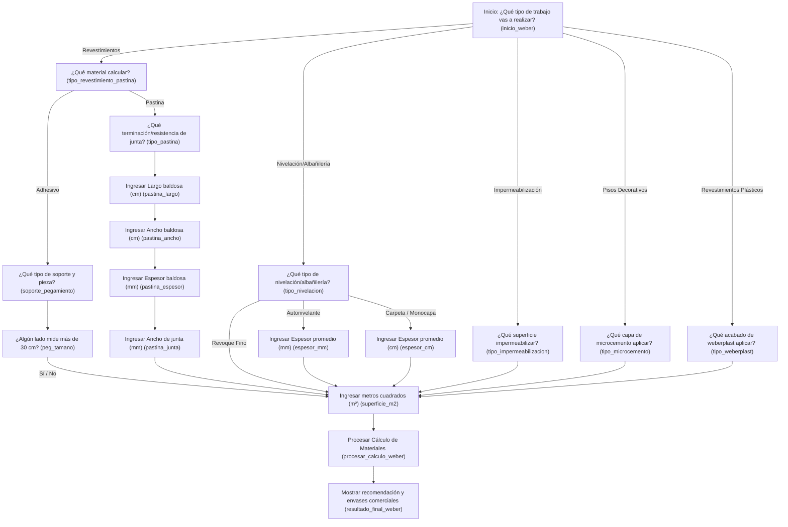

# MANUAL TÉCNICO DE SISTEMAS EXPERTOS E INTELIGENCIA ARTIFICIAL (RAG)

Este documento detalla todas las reglas de negocio, diagramas de flujo, nodos de conocimiento, fórmulas matemáticas, coeficientes de rendimiento, patrones de enrutamiento y prompts del sistema **SOLDASUR** para las marcas **PEISA**, **WEBER** y marcas dinámicas del motor RAG.

---

## 1. Sistema Experto de Calefacción PEISA (Backend)

Gestionado en el backend de Python por [expert_engine_peisa.py](../app/modules/expertSystem/expert_engine_peisa.py) consumiendo las reglas conversacionales del archivo de base de conocimientos [advisor_knowledge_base_peisa.json](../app/advisor_knowledge_base_peisa.json).

### 1.1. Flujo de Piso Radiante
*   **Fórmula de Carga Térmica:**
    $$\text{Carga total (W)} = \text{Superficie (m²)} \times \text{Coeficiente de Aislamiento} \times \text{Coeficiente de Zona}$$
*   **Coeficientes de Aislamiento:**
    *   Buena = `50`
    *   Regular = `75`
    *   Mala = `100`
*   **Coeficientes Geográficos (Zona):**
    *   Norte = `0.8`
    *   Centro = `1.0`
    *   Sur = `1.2`
*   **Regla de Recomendación de Calderas (Doble Servicio):**
    *   Si $\text{Superficie} < 100 \text{ m²}$: recomienda `Diva Tecno` o `Diva DS`.
    *   Si $\text{Superficie} \ge 100 \text{ m²}$ y $< 200 \text{ m²}$: recomienda `Prima Tec`.
    *   Si $\text{Superficie} \ge 200 \text{ m²}$: recomienda `Summa Condens` o `Prima Tec Smart`.

### 1.2. Flujo de Radiadores
*   **Fórmulas de Carga Térmica:**
    $$\text{Volumen (m³)} = \text{Largo (m)} \times \text{Ancho (m)} \times \text{Alto (m)}$$
    $$\text{Carga en Watts} = \text{Volumen (m³)} \times \text{Coeficiente de Aislamiento (W/m³)}$$
    $$\text{Carga en kcal/h} = \text{Carga en Watts} \times 0.86$$
*   **Coeficientes de Aislamiento (W/m³):**
    *   Alta (doble vidrio, aislada) = `35`
    *   Media (vidrio simple, parcialmente aislada) = `45`
    *   Baja (sin aislación significativa) = `55`
*   **Cálculo de Elementos del Radiador:**
    $$\text{Elementos necesarios} = \text{Math.ceil}\left(\frac{\text{Carga en kcal/h}}{120}\right)$$
    *(Asume un rendimiento estándar de 120 kcal/h por elemento de radiador)*.

---

## 2. Sistema Experto de Construcción Weber (Backend)

Gestionado en el backend de Python por [expert_engine_weber.py](../app/modules/expertSystem/expert_engine_weber.py) consumiendo las reglas conversacionales de [advisor_knowledge_base_weber.json](../app/advisor_knowledge_base_weber.json).

### 2.1. Diagrama de Flujo del Asesor (Mermaid)

El siguiente gráfico describe el recorrido secuencial de preguntas, entradas y variables del sistema experto para todos los tipos de obra de Weber:

### 2.2. Nodos de la Base de Conocimiento (`advisor_knowledge_base_weber.json`)

*   **1. `inicio_weber`:** ¿Qué tipo de trabajo vas a realizar en la obra?
    *   Colocación de Revestimientos (Cerámicos / Porcelanatos) $\rightarrow$ `tipo_revestimiento_pastina`
    *   Nivelación y Albañilería (Carpetas, revoques) $\rightarrow$ `tipo_nivelacion`
    *   Impermeabilización de Superficies $\rightarrow$ `tipo_impermeabilizacion`
    *   Pisos Decorativos (Microcementos) $\rightarrow$ `tipo_microcemento`
    *   Revestimientos Plásticos Decorativos (weberplast) $\rightarrow$ `tipo_weberplast`
*   **2. `tipo_revestimiento_pastina`:** ¿Qué material necesitás calcular para el revestimiento?
    *   Adhesivo (Pegamento) $\rightarrow$ `soporte_pegamiento`
    *   Pastina (Tomado de juntas) $\rightarrow$ `tipo_pastina`
*   **3. `soporte_pegamiento`:** ¿Qué tipo de revestimiento y soporte vas a utilizar?
    *   Cerámica Estándar (Carpeta/Revoque tradicional) [ID: `peg_classic`] $\rightarrow$ `peg_tamano`
    *   Porcellanatos (Baja absorción) [ID: `peg_flex`] $\rightarrow$ `peg_tamano`
    *   Colocación sobre cerámicas existentes [ID: `peg_psp`] $\rightarrow$ `peg_tamano`
    *   Vidrio / Venecitas (Baños y piscinas) [ID: `peg_glass`] $\rightarrow$ `peg_tamano`
*   **4. `peg_tamano`:** ¿Algún lado de la baldosa o pieza de revestimiento mide más de 30 cm?
    *   Sí (requiere doble encolado) [Variable `doble_encolado` = `"si"`] $\rightarrow$ `superficie_m2`
    *   No (colocación tradicional) [Variable `doble_encolado` = `"no"`] $\rightarrow$ `superficie_m2`
*   **5. `tipo_pastina`:** ¿Qué tipo de terminación/resistencia necesitás para la junta?
    *   Classic (Juntas finas hasta 5mm) [ID: `pastina_classic`] $\rightarrow$ `pastina_largo`
    *   Prestige (Porcellanatos y juntas de 2 a 15mm) [ID: `pastina_prestige`] $\rightarrow$ `pastina_largo`
    *   Lista para Usar (Acrílica de 1 a 4mm) [ID: `pastina_lista`] $\rightarrow$ `pastina_largo`
    *   Epoxi Max (Máxima resistencia e impermeabilidad) [ID: `pastina_epoxi`] $\rightarrow$ `pastina_largo`
*   **6. `pastina_largo`, `pastina_ancho`, `pastina_espesor`, `pastina_junta`:** Entradas numéricas del usuario:
    *   Largo de la baldosa en cm (variable: `pastina_largo`)
    *   Ancho de la baldosa en cm (variable: `pastina_ancho`)
    *   Espesor de la baldosa en mm (variable: `pastina_espesor`)
    *   Ancho de la junta deseada en mm (variable: `pastina_junta`)
    *   Todos enrutan secuencialmente hacia $\rightarrow$ `superficie_m2`
*   **7. `tipo_nivelacion`:** ¿Qué tipo de trabajo de albañilería / regularización vas a hacer?
    *   Autonivelante rápido (Capa fina interior) [ID: `autonivelante`] $\rightarrow$ `espesor_mm`
    *   Carpeta tradicional de nivelación [ID: `carpeta_tradicional`] $\rightarrow$ `espesor_cm`
    *   Revoque Fino exterior/interior [ID: `revoque_fino`] $\rightarrow$ `superficie_m2`
    *   Revoque Monocapa (Grueso+Fino liso) [ID: `revoque_monocapa`] $\rightarrow$ `espesor_cm`
*   **8. `espesor_mm` / `espesor_cm`:** Entradas de espesor técnico:
    *   Espesor promedio en mm (variable `espesor_medida`) $\rightarrow$ `superficie_m2`
    *   Espesor promedio en cm (variable `espesor_medida`) $\rightarrow$ `superficie_m2`
*   **9. `tipo_impermeabilizacion`:** ¿Qué tipo de superficie querés proteger de la humedad?
    *   Techados / Terrazas / Azoteas expuestas [ID: `imp_techos`] $\rightarrow$ `superficie_m2`
    *   Fachadas / Paredes Exteriores [ID: `imp_frentes`] $\rightarrow$ `superficie_m2`
    *   Cimientos / Barrera aisladora horizontal [ID: `imp_ceresita`] $\rightarrow$ `superficie_m2`
    *   Piscinas / Cisternas / Aljibes [ID: `imp_piscinas`] $\rightarrow$ `superficie_m2`
    *   Baños / Cocinas (Bajo revestimiento) [ID: `imp_banio`] $\rightarrow$ `superficie_m2`
*   **10. `tipo_microcemento`:** ¿Qué capa del sistema de microcemento decorativo vas a colocar?
    *   Capa Base niveladora (weber microbase) [ID: `microcemento_base`] $\rightarrow$ `superficie_m2`
    *   Capa Color terminación (weber microcolor) [ID: `microcemento_color`] $\rightarrow$ `superficie_m2`
*   **11. `tipo_weberplast`:** ¿Qué tipo de acabado texturado decorativo (weberplast) vas a aplicar?
    *   Textura Fina (Llaneado / Rodillado fino) [ID: `weberplast_fino`] $\rightarrow$ `superficie_m2`
    *   Textura Media (Rulato / Travertino medio) [ID: `weberplast_medio`] $\rightarrow$ `superficie_m2`
    *   Textura Gruesa (Acabado rústico grueso) [ID: `weberplast_grueso`] $\rightarrow$ `superficie_m2`
*   **12. `superficie_m2`:** Entrada final: Superficie total en m² (variable `metros_cuadrados`) $\rightarrow$ `procesar_calculo_weber`

### 2.3. Lógica de Cálculo y Rendimientos (`expert_engine_weber.py`)

El motor de cálculo busca el soporte de obra seleccionado en el diccionario de rendimientos estáticos para realizar el cómputo exacto:

| Categoría | Soporte/Producto (`soporte_obra`) | Nombre Comercial Comercializado | Rendimiento Base | Unidad de Medida |
| :--- | :--- | :--- | :---: | :---: |
| **Adhesivos** | `peg_classic` | Weber gris cerámicos | 5.0 | $kg/m^2$ |
| | `peg_flex` | Weber flex porcellanato | 5.0 | $kg/m^2$ |
| | `peg_psp` | Weber piso sobre piso 12hs | 6.0 | $kg/m^2$ |
| | `peg_glass` | Weber glass | 4.5 | $kg/m^2$ |
| **Pastinas** | `pastina_classic` | Weber pastina classic | *Especial* | Densidad: 1.60 |
| | `pastina_prestige` | Weber pastina prestige | *Especial* | Densidad: 1.65 |
| | `pastina_lista` | Weber pastina lista | *Especial* | Densidad: 1.50 |
| | `pastina_epoxi` | Weber pastina epoxi max | *Especial* | Densidad: 1.80 |
| **Nivelación**| `autonivelante` | Weber autonivela | 1.6 | $kg/m^2$ por mm de espesor |
| | `carpeta_tradicional` | Weber carpeta | 20.0 | $kg/m^2$ por cm de espesor |
| | `revoque_fino` | Weber fino | 3.0 | $kg/m^2$ (fijo) |
| | `revoque_monocapa` | Weber monocapa prisma | 15.0 | $kg/m^2$ por cm de espesor |
| **Impermeabil.**| `imp_techos` | Weberdry techos con poliuretano | 1.5 | $kg/m^2$ (fijo) |
| | `imp_frentes` | Weberdry frentes y muros | 0.8 | $kg/m^2$ (fijo) |
| | `imp_ceresita` | Webertec ceresita | 1.5 | $kg/m^2$ (fijo) |
| | `imp_piscinas` | Weber piscinas | 2.5 | $kg/m^2$ (fijo) |
| | `imp_banio` | Weber impermeable cerámicos con ceresita | 1.5 | $kg/m^2$ (fijo) |
| **Microcemento**| `microcemento_base` | Weber microbase | 2.0 | $kg/m^2$ (fijo) * |
| | `microcemento_color` | Weber microcolor | 1.0 | $kg/m^2$ (fijo) * |
| **Weberplast** | `weberplast_fino` | Weberplast llaneado | 1.6 | $kg/m^2$ (fijo) |
| | `weberplast_medio` | Weberplast rulato travertino medio | 2.2 | $kg/m^2$ (fijo) |
| | `weberplast_grueso` | Weberplast rulato travertino grueso | 3.2 | $kg/m^2$ (fijo) |

*\* Nota: Los productos de microcemento son bicomponentes. Requieren un producto auxiliar (`weber emulsión`) calculado con un factor de `1/3` para la base y `1/2` para el color respectivamente.*

### 2.4. Fórmulas Matemáticas de Cómputo

#### 1. Adhesivos (Pegamentos)
Si el usuario selecciona doble encolado (`doble_encolado == "si"`), se adicionan **2.0 kg/m²** de consumo técnico por especificación de colocación en piezas grandes (baldosa de más de 30 cm):
$$\text{Rendimiento Ajustado} = \text{Rendimiento Base} + (\text{2.0 si doble encolado, 0.0 de lo contrario})$$
$$\text{Kg Requeridos} = \text{Superficie (m²)} \times \text{Rendimiento Ajustado}$$

#### 2. Pastinas (Fórmula Física de Consumo de Juntas)
El cálculo del consumo de pastina por metro cuadrado se realiza mediante la siguiente ecuación volumétrica:
$$\text{Consumo Base (kg/m²)} = \frac{(\text{Largo} + \text{Ancho}) \times \text{Espesor} \times \text{Junta} \times \text{Densidad}}{(\text{Largo} \times \text{Ancho}) \times 10}$$
*Donde: Largo y Ancho están en cm; Espesor y Junta están en mm; Densidad está especificada en la tabla anterior.*
$$\text{Kg Requeridos} = \text{Superficie (m²)} \times \text{Consumo Base (kg/m²)}$$

#### 3. Nivelación / Albañilería con Espesores variables
* **Autonivelante (espesor en mm)**:
  $$\text{Kg Requeridos} = \text{Superficie (m²)} \times \text{Espesor (mm)} \times 1.6$$
* **Carpeta o Monocapa (espesor en cm)**:
  $$\text{Kg Requeridos} = \text{Superficie (m²)} \times \text{Espesor (cm)} \times \text{Rendimiento Base}$$

#### Desperdicio y Empaque Comercial
Para garantizar que el cliente no se quede sin material debido a recortes o irregularidades del suelo, el motor experto aplica las siguientes reglas de cierre:

1. **Margen de Desperdicio Obligatorio (10%)**:
   $$\text{Kg Totales} = \text{Kg Requeridos} \times 1.10$$

2. **Cómputo de Envases Comerciales (Bolsas o Tachos)**:
   * **Adhesivos / Nivelación / Revestimientos**: Se comercializan en bolsas o tachos de **25 kg**. Se redondea siempre al entero superior:
     $$\text{Cantidad Bolsas} = \text{ceil}\left(\frac{\text{Kg Totales}}{25}\right)$$
   * **Pastinas**: Se comercializan en potes o bolsas de **2 kg** (excepto Epoxi Max que viene en kit de **5 kg**). Se redondea al envase superior:
     $$\text{Cantidad Envases} = \text{ceil}\left(\frac{\text{Kg Totales}}{\text{Peso Envase}}\right)$$

---

## 3. Clasificador de Intenciones y Enrutamiento (Orquestador Backend)

Gestionado en Python por la clase `IntentClassifier` en [orchestrator.py](../app/orchestrator.py) al recibir consultas en el endpoint unificado `/api/chat`.

### 3.1. Tipos de Intención (`IntentType`)
*   `GUIDED_CALCULATION` ("guided_calculation"): Detecta frases para iniciar o continuar calculadoras.
*   `FREE_QUERY` ("free_query"): Consultas genéricas o teóricas de los productos.
*   `PRODUCT_SEARCH` ("product_search"): Intenciones de búsqueda en catálogos (precios, stock, modelos).
*   `HYBRID` ("hybrid"): Mezcla inteligente de recomendación RAG con un llamado de atención para iniciar un flujo guiado.
*   `SWITCH_MODE` ("switch_mode"): Petición del usuario para cambiar de modo RAG a experto o viceversa.

### 3.2. Ruteo Dinámico Basado en Configuración
El orquestador no tiene marcas hardcodeadas. Lee dinámicamente el archivo de registro [brands_registry.json](../configs/brands_registry.json) in su inicialización para asociar intenciones de conversación:
1.  **Detección Directa**: Si el mensaje del usuario contiene alguna palabra clave declarada en `direct_keywords` (minúsculas), asocia de inmediato la consulta a esa marca.
2.  **Detección Semántica**: Si no hay palabras clave directas, calcula la distancia semántica del mensaje contra la propiedad `anchor_text` (ancla temática) de cada marca registrada. Si supera el umbral de similitud, la enruta a esa marca.
3.  **Invocación RAG**: Importa en caliente el script de Python declarado en `rag_module` y llama a la función `rag_function` definida para resolver la consulta.

---

## 4. Personalidad e Inferencia del LLM (Ollama)

La parametrización de temperatura, limitación de tokens de salida y las directrices del rol de Soldy están centralizadas en el archivo de configuración global [prompts.json](../configs/prompts.json).

### 4.1. Reglas Generales de Personalidad (Rol de Soldy)
*   **Español rioplatense argentino**: Uso de voseo natural y profesional (*vos*, *tenés*, *podés*, *querés*). Está prohibido usar lunfardo vulgar o modismos de calle callejeros (como "Che", "mirá", "chequeá").
*   **Respuestas muy cortas**: Máximo de 2 o 3 oraciones (aproximadamente 40-50 palabras) para facilitar la lectura fluida en el widget web.
*   **Prohibición de Markdown**: El modelo de lenguaje tiene estrictamente prohibido utilizar marcado Markdown (como asteriscos de negrita, almohadillas de títulos o listas de guiones). Debe devolver texto plano limpio.
*   **Consultas de Precios**: Si el cliente pregunta precios, Soldy responde de forma corta que los consulte en el local, y pregunta en cuál ciudad se encuentra (Ushuaia o Río Grande) para derivarlo.

---

## 5. Arquitectura Dinámica del Sistema Experto

El frontend y backend no necesitan de código manual para servir nuevas calculadoras.
1.  **Endpoints Genéricos**: `/api/expert/{brand}/start` y `/api/expert/{brand}/reply` atienden las peticiones del chat de cualquier marca.
2.  **Carga Dinámica**: El servidor busca un módulo en `app/modules/expertSystem/expert_engine_{brand_lower}.py` y lo ejecuta.
3.  **Fallback Genérico**: Si no hay lógica personalizada en Python, levanta una instancia genérica de `ExpertEngine` de PEISA usando únicamente la estructura declarada en el archivo de base de conocimientos `app/advisor_knowledge_base_{brand_lower}.json`, interpretando nodos de tipo opciones, entradas de usuario, fórmulas matemáticas y respuestas finales de forma 100% automatizada.
